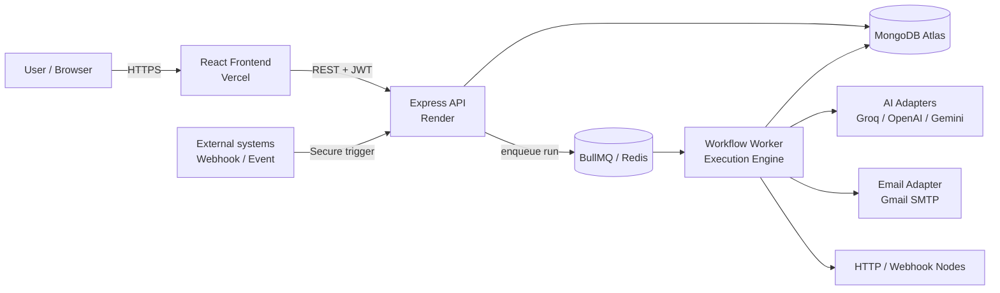

# Relay — AI Workflow Orchestrator

<div align="center">

**Compose, run, pause, approve and audit AI-powered workflows — durably, safely, and without ever repeating a side effect.**

[Live Demo](https://relay-workflow-automation.vercel.app/) · [API Health](https://relay-workflow-automation.onrender.com/health) · [Node.js](https://nodejs.org/) · [MongoDB](https://www.mongodb.com/atlas) · [BullMQ](https://docs.bullmq.io/) · [Docker](https://docs.docker.com/compose/)

[**Live App**](https://relay-workflow-automation.vercel.app/) · [**API Health**](https://relay-workflow-automation.onrender.com/health) · [**Source Code**](https://github.com/mhd-faraz/Relay-Workflow-Automation)

</div>

---

## Live Links

| Resource | URL |
|---|---|
| Frontend (Vercel) | https://relay-workflow-automation.vercel.app/ |
| Backend API + Worker + Redis (Render) | https://relay-workflow-automation.onrender.com/ |
| Backend health check | https://relay-workflow-automation.onrender.com/health |
| GitHub repository | https://github.com/mhd-faraz/Relay-Workflow-Automation |

> If the backend is hosted on a free Render instance, it may spin down when idle. The first request after inactivity can take up to a minute while the service wakes up.

Relay is an AI workflow automation platform that lets users design, trigger, monitor, and approve complex task flows. The system combines a visual workflow builder, AI-powered decision nodes, background execution workers, and human approval checkpoints to safely orchestrate real-world actions.

This project is designed for teams that need structured automation without losing control over side effects, retries, or compliance-sensitive operations.

## Why this project exists

Modern businesses often need workflows that combine:

- AI reasoning
- business logic and branching
- human review for high-impact actions
- durable execution and auditing
- external integrations such as email, HTTP calls, and webhooks

Relay provides a simple orchestration layer to coordinate these parts while keeping execution reliable and traceable.

## Key features

- Visual workflow builder for composing node-based flows
- AI decision nodes with provider abstraction for Groq, OpenAI, and Gemini
- Durable execution with MongoDB-backed state tracking
- Background job processing using BullMQ and Redis
- Human approval gates before sensitive actions run
- Exactly-once style protection for repeat-prone side effects
- Run tracing with step inputs, outputs, status, and timing
- JWT-based authentication and role-scoped workflow access
- Docker support for a full local stack
- Seeded demo workflows for quick testing and demos

## Architecture overview



### Request flow

1. The user creates or publishes a workflow in the frontend.
2. The backend stores the workflow definition and run metadata in MongoDB.
3. A workflow is triggered through the API or a secure webhook endpoint.
4. The API enqueues a job in Redis via BullMQ.
5. The worker picks up the queued job and executes the workflow graph.
6. Each step is persisted before and after execution to support crash recovery and replay safety.
7. If the workflow reaches an approval node, execution pauses until a human approves or rejects it.
8. The engine resumes from the last valid state and continues the remaining nodes.

### Why this architecture matters

This design separates the system into three critical layers:

- Frontend layer: user interaction, workflow construction, and run visibility
- API layer: authentication, workflow management, run orchestration, and webhook intake
- Worker layer: deterministic execution, state persistence, retry-safe processing, and side-effect control

This makes the platform suitable for automation workflows where correctness, human review, and traceability are essential.

## Tech stack

| Layer | Technology |
|---|---|
| Backend | Node.js + Express |
| Frontend | React + Vite |
| Workflow UI | React Flow |
| Database | MongoDB + Mongoose |
| Queue | BullMQ + Redis |
| Authentication | JWT + bcryptjs |
| AI providers | Groq, OpenAI, Gemini |
| Email | Nodemailer |
| Testing | Jest + Supertest |
| Containerization | Docker + Docker Compose |

## Project structure

```text
Relay-Capstone/
├── docker-compose.yml
├── README.md
├── backend/
│   ├── Dockerfile
│   ├── package.json
│   ├── seeds/
│   │   └── demoWorkflows.js
│   ├── src/
│   │   ├── adapters/
│   │   ├── config/
│   │   ├── controllers/
│   │   ├── engine/
│   │   ├── middleware/
│   │   ├── models/
│   │   ├── routes/
│   │   ├── utils/
│   │   ├── validators/
│   │   ├── workers/
│   │   ├── index.js
│   │   └── ...
│   └── tests/
│       ├── engine.test.js
│       ├── guardrails.test.js
│       └── workflow.test.js
├── frontend/
│   ├── Dockerfile
│   ├── nginx.conf
│   ├── package.json
│   ├── vite.config.js
│   ├── index.html
│   └── src/
│       ├── components/
│       ├── context/
│       ├── pages/
│       ├── services/
│       ├── App.jsx
│       ├── main.jsx
│       └── index.css
└── .env.example (if present in your setup)
```

## Prerequisites

Before running the project locally, make sure you have:

- Node.js 20 or higher
- npm
- Docker and Docker Compose
- MongoDB instance or MongoDB Atlas connection
- Redis instance or Docker Redis
- At least one AI provider API key for real execution
- Optional Gmail app password for email-send nodes

## Environment variables

The backend expects the following environment variables.

Create a `.env` file in the project root for Docker Compose usage or in the backend folder for local development.

```env
PORT=3000
NODE_ENV=development
MONGODB_URI=mongodb://localhost:27017/relay
REDIS_HOST=localhost
REDIS_PORT=6379
AI_PROVIDER=groq
OPENAI_API_KEY=
GEMINI_API_KEY=
GROQ_API_KEY=
GMAIL_USER=
GMAIL_APP_PASSWORD=
JWT_SECRET=change_this_in_production
MAX_STEPS_PER_RUN=100
```

### Variable notes

| Variable | Required | Purpose |
|---|---|---|
| `MONGODB_URI` | Yes | MongoDB database connection string |
| `REDIS_HOST` | Yes | Redis host name or IP |
| `REDIS_PORT` | Yes | Redis port |
| `AI_PROVIDER` | Yes | Provider to use: `groq`, `openai`, or `gemini` |
| `GROQ_API_KEY` | Conditional | Required when using Groq |
| `OPENAI_API_KEY` | Conditional | Required when using OpenAI |
| `GEMINI_API_KEY` | Conditional | Required when using Gemini |
| `GMAIL_USER` | Optional | Gmail account for outbound email |
| `GMAIL_APP_PASSWORD` | Optional | App password for Gmail SMTP |
| `JWT_SECRET` | Yes | Secret for signing and verifying JWTs |
| `MAX_STEPS_PER_RUN` | Optional | Maximum number of workflow steps per run |

> Important: never commit real secrets or production credentials into version control.

## Local development setup

### Option 1: Run with Docker Compose

From the project root:

```bash
docker compose up --build
```

This starts:

- Redis on port `6379`
- Backend API on port `3000`
- Frontend on port `5174` via nginx

### Option 2: Run backend and frontend separately

#### Backend

```bash
cd backend
npm install
npm run dev
```

This uses `nodemon` and runs the Express server plus the worker startup flow.

#### Frontend

```bash
cd frontend
npm install
npm run dev
```

The Vite dev server typically runs on:

- http://localhost:5173

## Seed demo data

The backend includes demo workflows for quick testing.

```bash
cd backend
npm run seed
```

This populates the database with example workflows that can be used for demonstration and validation.

## API overview

The backend exposes the following main routes.

### Authentication

- `POST /api/auth/signup`
- `POST /api/auth/login`
- `GET /api/auth/me`

### Workflows

- `POST /api/workflows`
- `GET /api/workflows`
- `GET /api/workflows/:id`
- `PUT /api/workflows/:id`
- `POST /api/workflows/:id/publish`
- `DELETE /api/workflows/:id`
- `POST /api/workflows/:id/trigger`

### Runs and approvals

- `GET /api/runs`
- `GET /api/runs/:id`
- `GET /api/runs/:id/steps`
- `GET /api/approvals`
- `POST /api/approvals/:id/resolve`

### Webhooks

- `POST /api/webhooks/:id`

### Health check

- `GET /health`

## Example usage

### Login

```bash
curl -X POST http://localhost:3000/api/auth/login \
  -H "Content-Type: application/json" \
  -d '{"email":"user@example.com","password":"password123"}'
```

### Trigger a workflow

```bash
curl -X POST http://localhost:3000/api/workflows/<workflow_id>/trigger \
  -H "Authorization: Bearer <token>" \
  -H "Content-Type: application/json" \
  -d '{"customer":"Acme Corp","amount":1250}'
```

## Security and production considerations

This project includes a basic production-ready foundation, but production deployment still requires operational hardening.

Recommended practices:

- Use strong random `JWT_SECRET` values in production
- Use a managed MongoDB deployment such as MongoDB Atlas
- Use managed Redis in production or a secure Redis instance
- Restrict CORS origins to trusted frontend domains
- Use HTTPS everywhere
- Store secrets in environment variables or a secret manager
- Rotate API keys regularly
- Restrict webhook access using secret validation
- Set a realistic `MAX_STEPS_PER_RUN` limit to prevent runaway workflows

## Testing

The backend includes automated tests for workflow execution, guardrails, and engine behavior.

Run tests with:

```bash
cd backend
npm test
```

The frontend also includes linting and build validation:

```bash
cd frontend
npm run build
npm run lint
```

## Deployment notes

For deployment, a typical production setup is:

- Frontend: Vercel or Netlify
- Backend: Render, Railway, or a VPS/container host
- Database: MongoDB Atlas
- Queue: Redis hosted service or containerized Redis

Ensure these are configured before release:

- Valid `MONGODB_URI`
- Valid Redis host and port
- Correct `JWT_SECRET`
- AI provider API keys
- Optional Gmail SMTP credentials for email nodes
- Allowed frontend origins in CORS configuration

## License

This project is currently distributed under the ISC license unless otherwise stated in the repository.

## Contributing

Contributions are welcome. If you plan to contribute:

1. Fork the repository.
2. Create a feature branch.
3. Commit your changes with clear messages.
4. Run tests and validation checks.
5. Open a pull request with a concise summary.

## Summary

Relay is a practical workflow automation platform that balances automation, human control, and reliable execution. It is suitable for AI-assisted operational workflows where actions must happen safely, traceably, and only when the system is confident enough to proceed.

If you are preparing this repo for a capstone, portfolio, or assessment, this README is structured to communicate technical depth, architecture, setup, deployment readiness, and real-world engineering thinking.

---

## Authentication & Security

- **JWT + bcrypt** — passwords are hashed with bcrypt; tokens expire after 7 days.
- **Tenant isolation** — all queries are scoped to the authenticated user (plus shared templates), and every mutation is scoped by `userId` at the controller level.
- **Webhooks** — the trigger endpoint does not use a JWT. It is designed for server-to-server use and is authenticated by a per-workflow secret in the `x-webhook-secret` header, the same model used by Stripe and GitHub webhooks.
- **Approval enforcement** — sensitive nodes cannot run without a saved approval record; the check lives in the engine.
- **Input hardening** — prompt-injection sanitization, schema-validated AI output, step caps and request timeouts.
- **Rate limiting** — middleware is in place for the API (see Known Limitations for what is not yet covered).

---

## Testing

```bash
cd backend
npm test
```

17 tests across three suites, using an isolated test database and the mock AI adapter (no live API calls):

| Suite | Covers |
|---|---|
| `workflow.test.js` | CRUD and publish-validation rules (no nodes, missing entry node, editing/deleting a published workflow) |
| `engine.test.js` | DAG execution, condition branching, step cap stopping a cyclic workflow, **crash recovery** (a pre-completed step is not re-executed), approval gates pausing a run |
| `guardrails.test.js` | Prompt-injection detection and sanitization; sensitive node unreachable without a saved approval |

---

## Known Limitations

- **Single shared email identity.** All *Send Email* actions go out from one configured Gmail account (similar to a company `noreply@`). Per-user sending would require Google OAuth and per-user token storage.
- **No per-user quotas on side-effecting nodes.** A malicious account could trigger many email-sending runs; production use would need per-user limits.
- **Small node library.** Six node types cover the demonstrated use cases; tools like n8n ship hundreds of integrations.
- **AI quality depends on prompts.** Schema validation catches malformed output, but a weak prompt can still yield a valid-but-poor answer. This is inherent to LLM-backed systems.
- **Cold starts on free hosting tiers.** The first request after idle time may be slow.

---

## Roadmap

- [ ] Live, node-by-node highlighting on the canvas while a run executes
- [ ] OAuth-based per-user email and Slack sending
- [ ] Richer node library (Slack, Google Sheets, database writes)
- [ ] Per-user workflow quotas and billing hooks
- [ ] CI pipeline (lint + tests on every pull request)

---

## Contributing

Contributions are welcome.

1. Fork the repository and create a feature branch: `git checkout -b feature/your-feature`
2. Make your changes and add tests where relevant (`npm test` must pass)
3. Commit with a clear message and open a pull request describing the change

For larger changes, please open an issue first to discuss the approach.

---

## License

Released under the MIT License. See the `LICENSE` file for details.

---

## Author

**Mohammad Faraz** — Full Stack MERN Developer & Generative AI Engineer
GitHub: [@mhd-faraz](https://github.com/mhd-faraz)

Built as a capstone project for the **Airtribe AI-First Software Engineering Program**.